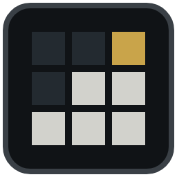
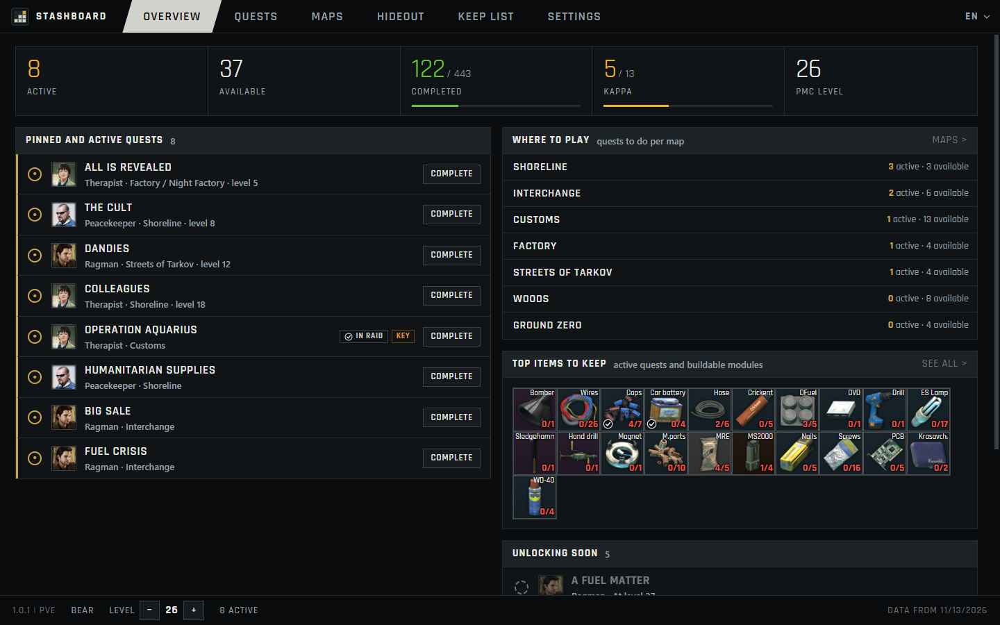
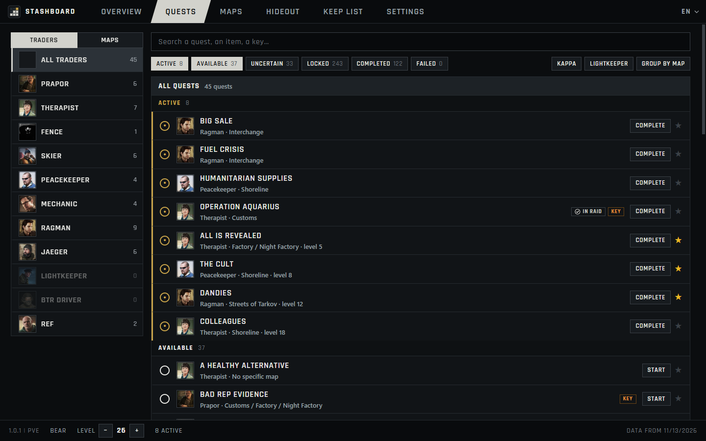
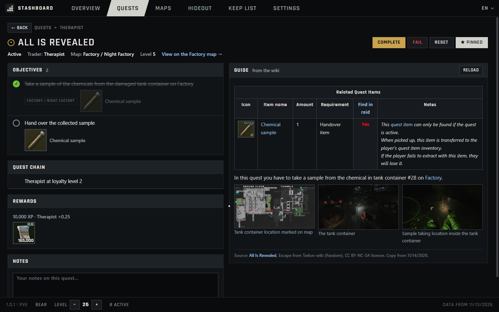
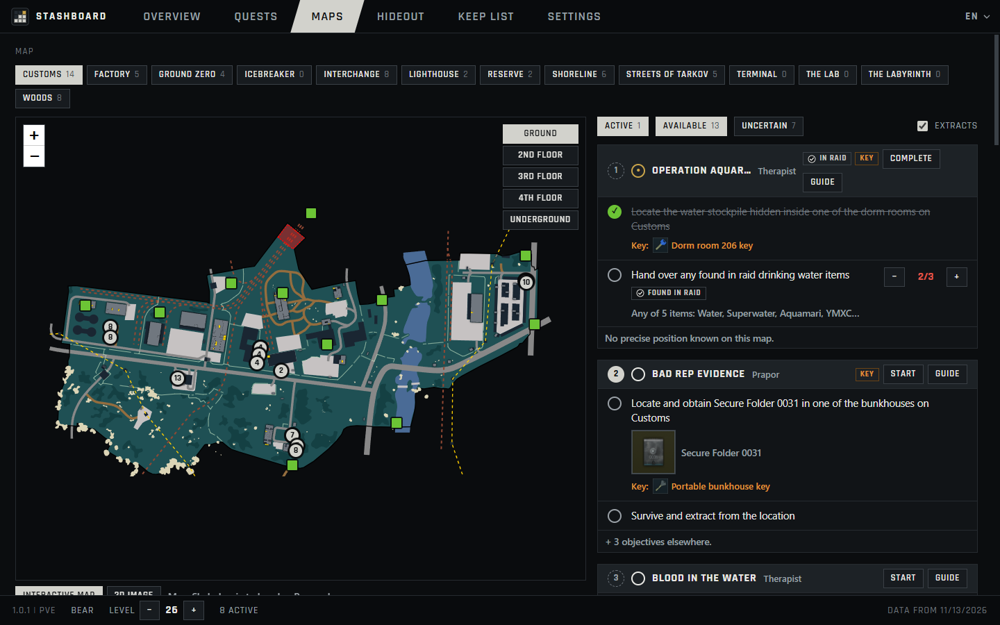
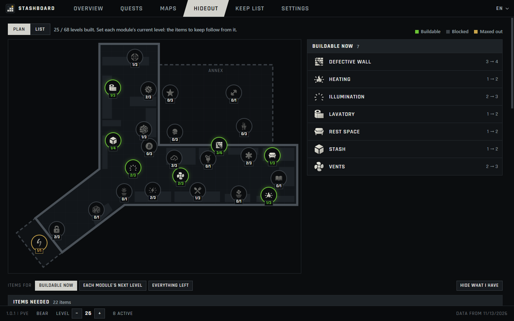
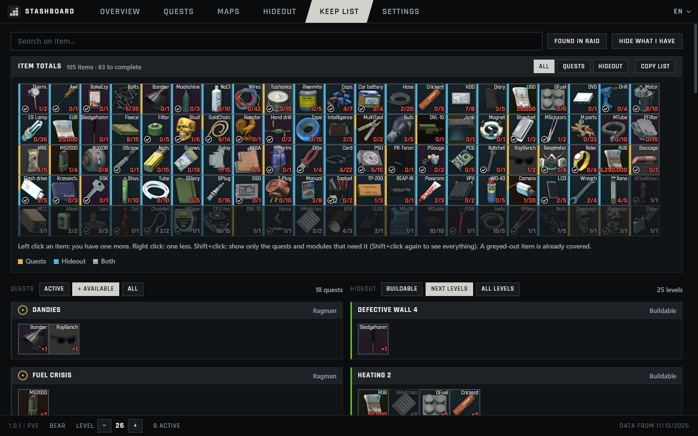

  

<h1 align="center">Tarkov Stashboard</h1>

  A free desktop companion for <b>Escape from Tarkov</b>. 
  Track your quests, read the guide next to each one, plan your Hideout, and know which items to keep.

  <a href="https://github.com/grcpils/tarkov-stashboard-releases/releases/latest"><b>⬇ Download for Windows</b></a>

  

  Free · No account · No ads · Your progress stays on your PC

---

## What you get

- **Quests that track themselves.** Accept, complete or fail a quest in game and the app follows along.
- **The wiki guide next to every quest**, with its images, so you stop alt-tabbing to a browser.
- **Interactive maps** with floors, quest markers and extracts.
- **A Hideout planner** that shows what you can build right now and what is missing.
- **A keep list**: every item your quests and Hideout still need, so you know what not to sell.
- **PvE and PvP** tracked separately.
- **English and French**, including quest, item and map names.

<table>
  <tr>
    <td> <b>Quests</b>: filter by trader, map and status</td>
    <td> <b>Quest page</b>: objectives next to the wiki guide</td>
  </tr>
  <tr>
    <td> <b>Maps</b>: floors, quest markers and extracts</td>
    <td> <b>Hideout</b>: what you can build right now</td>
  </tr>
  <tr>
    <td colspan="2"> <b>Keep list</b>: every item your quests and Hideout need</td>
  </tr>
</table>

Screenshots show sample progress, not a real profile.

## Install

1. Open the [latest release](https://github.com/grcpils/tarkov-stashboard-releases/releases/latest).
2. Download **`Tarkov-Stashboard-Setup`** and run it. It needs no administrator rights and keeps itself up to date.
3. Windows may say **"Windows protected your PC"** because the app is not signed. Click **More info**, then **Run anyway**.

Prefer not to install anything? Take **`Tarkov-Stashboard-Portable`** instead: a single file you can run from anywhere. It does not update itself, so come back here for new versions.

Works on Windows 10 and 11.

### Uninstall

Open **Windows Settings > Apps > Installed apps**, find Tarkov Stashboard and uninstall it. Your progress is kept. To remove it too, delete the `%APPDATA%TarkovStashboard` folder.

## Getting started

1. In **Settings**, pick your game mode (PvE or PvP) and your faction.
2. Link the game's `Logs` folder. The app usually finds it and offers it to you.
3. If the game wiped recently, set the wipe date so older quests are ignored.

That's it. Quests update on their own from then on. A quest finished in raid shows up once you are back in the menus.

Some quests are marked **uncertain**: the app cannot tell whether you have unlocked them. Click **I have it** when you do.

## Is it safe to use?

Tarkov Stashboard only reads the log files the game writes to your disk. It never reads game memory, never draws over the game, and never touches the game client.

Nothing about you leaves your computer. Your progress is saved in `%APPDATA%TarkovStashboard`, and the app only goes online to fetch game data, quest guides and its own updates.

To move your progress to another PC, export it from **Settings > Backup** and import it there.

## Feedback

Found a bug or have an idea? [Open an issue](https://github.com/grcpils/tarkov-stashboard-releases/issues), everything is welcome. Mentioning the app version (bottom-left corner) helps a lot.

If a quest looks wrong, try **Settings > Update game data** first.

## Thanks

Tarkov Stashboard only exists thanks to the community:

| Project | What comes from it | License |
|---|---|---|
| [tarkov.dev](https://tarkov.dev) by [the-hideout](https://github.com/the-hideout) | Quest, item and Hideout data, icons, interactive maps | MIT (code and map settings) |
| [Escape from Tarkov Wiki](https://escapefromtarkov.fandom.com) (Fandom) | Quest guides and their images, with a link back to each page | [CC BY-NC-SA](https://www.fandom.com/licensing) |
| [tarkov-data-overlay](https://github.com/tarkovtracker-org/tarkov-data-overlay) by tarkovtracker-org | Quest corrections | MIT |
| Community map authors, via tarkov.dev | 2D map images, credited under each map in the app | Belongs to each author |
| [Rajdhani](https://fonts.google.com/specimen/Rajdhani) by Indian Type Foundry | Interface font | SIL Open Font License 1.1 |

None of these projects is affiliated with this app.

---

Tarkov Stashboard is an unofficial fan tool, free and with no commercial purpose. It is not affiliated with or endorsed by Battlestate Games. Escape from Tarkov and all related names, images and game content are trademarks or property of Battlestate Games Limited. The app is provided as is, without warranty of any kind.
